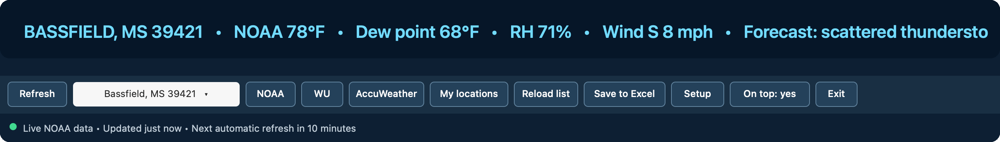

# Three-Source Weather Ticker

A small, source-labeled Windows desktop ticker for weather analysts, hobbyists,
survey work, and volunteer spotter coordination. It is deliberately restricted
to three weather providers:

1. NOAA / National Weather Service
2. Weather Underground
3. AccuWeather



_Animated rendering of the production Windows interface and its scrolling
ticker behavior._

## Download and install

[**Download the latest one-click installer**](https://github.com/tmccoy678/WeatherTicker/releases/latest/download/Weather-Ticker-One-Click-Installer.zip)

1. Open the downloaded ZIP.
2. Double-click **`1 - DOUBLE-CLICK TO INSTALL WEATHER TICKER.cmd`**.

The installer is self-contained, needs no administrator access, creates a
**Weather Ticker** shortcut on the Desktop, and opens the ticker immediately.
Bassfield, Mississippi 39421 is included as the initial location.

Windows may warn because this personal project is not commercially code-signed.
Run it only when it came from this repository. Do not disable Windows security
globally. The release notes include a SHA-256 checksum for independent
verification.

## What it does

- Shows live NOAA observations, forecast text, and active NWS alerts.
- Opens the official NOAA, Weather Underground, and AccuWeather pages for the
  selected location.
- Optionally displays live Weather Underground PWS and AccuWeather readings
  when the user supplies authorized API credentials.
- Maintains an Excel-editable GPS, elevation, call-sign, and spotter roster.
- Handles practical multi-location rosters, including dozens of spotters,
  while refreshing only the selected point.
- Appends source-labeled snapshots to an Excel-ready CSV file.
- Can remain above other windows and refresh every 2–120 minutes.
- Keeps the window responsive while weather providers answer or time out.

## Privacy and network boundary

There are no advertisements, analytics, telemetry, background services, or
accounts. Nothing continues running after **Exit**.

Programmatic requests are allowlisted to:

- `api.weather.gov`
- `api.weather.com`
- `dataservice.accuweather.com`

Clickable source links are restricted to official NOAA/NWS, Weather
Underground, and AccuWeather HTTPS hosts. Optional API keys are protected with
Windows DPAPI for the current Windows user and computer; they are never stored
in this repository or in the installed application folder.

## Requirements

- Windows 10 or Windows 11
- Windows PowerShell 5.1
- Internet access for live weather

No Python, Node.js, browser extension, or administrator account is required.

## Location roster

The editable roster is stored at:

```text
%LOCALAPPDATA%\ThreeSourceWeatherTicker\locations.csv
```

Use **My locations** to open it in Excel, save and close Excel, and then choose
**Reload list**. Supported fields include GPS coordinates, surveyed elevation,
spotter name, call sign, Weather Underground station/page, and AccuWeather
location/page. NOAA API requests use up to four decimal places, as required by
the [NWS API](https://weather-gov.github.io/api/general-faqs); the roster and
exported snapshots retain the coordinates you entered.

Each distinct GPS row owns its optional Weather Underground and AccuWeather
fields. Blank provider fields leave the row unlinked and the ticker shows that
provider's setup prompt. The row matching the Setup fallback coordinates can
use the provider identifiers saved in Setup.

Surveyed elevations are labeled as local metadata and are never represented as
provider measurements. Use this source-labeled display for situational
awareness, and receive warnings through NWS and local emergency-alert channels.
Use established local channels for spotter communication.

## Updating

Run a newer installer over the existing copy. Program files are replaced while
saved settings, the location roster, and optional encrypted API keys remain in
place.

## Source and license

The complete readable PowerShell and batch source is included here. The project
is licensed under the [MIT License](LICENSE), because even a tiny weather ticker
deserves an unnecessarily official open-source license.
